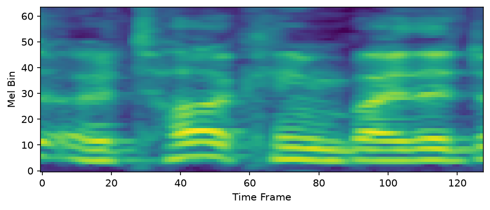
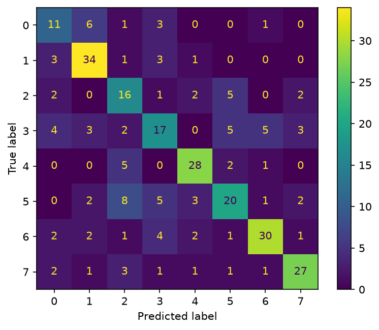

## CNN Speech Emotion Recognition

**Period:** August 2026 · **Type:** course project (my first hands-on project in audio understanding).

A course project that treats log-Mel spectrograms as images and classifies **8 emotions** on the **RAVDESS** speech subset (1,440 clips) with a LeNet-style CNN in PyTorch.

### Pipeline & Model

- **Data**: RAVDESS speech subset — 1,440 clips, 24 actors, 8 balanced emotion classes
- **Features**: 48 kHz → 16 kHz resampling, 64-band log-Mel spectrogram (128 frames), treated as a single-channel "image" `[1, 64, 128]`
- **Network**: 3 × (Conv2d + ReLU + MaxPool) + 2 fully connected layers — ~1.07M parameters
- **Training**: Adam (lr=1e-3) · batch size 32 · 40 epochs · 80/20 split (seed=42) · NVIDIA RTX 4080

### Result

- **63.54%** test accuracy (183 / 288), **5.1×** the 12.5% random baseline
- Confusion analysis: high-arousal pairs **fearful ↔ happy** and **neutral ↔ calm** confuse most — they share similar acoustic features (pitch, speaking rate); **calm (81%)** and **angry (78%)** are recognized best

### Engineering note

`MelSpectrogram(sample_rate=...)` only sets the frequency scale — it does **not** resample the waveform. Forgetting to downsample 48 kHz → 16 kHz first silently degraded accuracy:

| Setting | Test accuracy |
|---|---|
| Without resampling (bug) | 46.2% |
| With resampling (fixed) | **63.5%** |

> Lesson: every parameter in a data pipeline must be cross-checked — "it runs" is not "it runs correctly."

Includes a full experiment report and line-by-line Chinese walkthroughs of the source code.

[Source code and report →](https://github.com/xinkaima1/cnn-speech)
