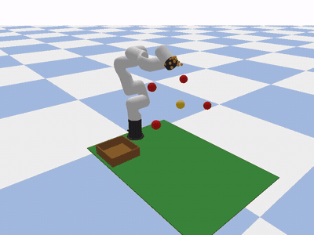
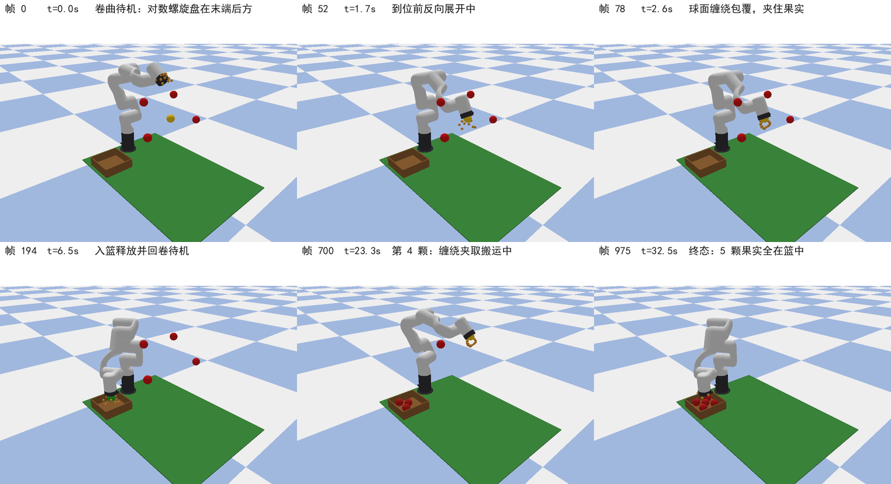

## xArm6 Strawberry-Reaching Simulation

**Period:** November 2026 · **Type:** course project (positioning-accuracy verification of a bionic strawberry-picking manipulator).

The positioning-accuracy verification part of an undergraduate course design on a bionic strawberry-picking manipulator, built with **PyBullet** under WSL2. It comes from my agricultural-engineering background.

### Scope (explicit boundaries)

- Pure simulation — **no end-effector model**, no grasping, no contact or force control
- Accuracy verification targets one thing only: the 6-DoF xArm6 end link (link6) reaching **5 hardcoded spatial target points** in sequence
- Method: PyBullet `calculateInverseKinematics` (position-only, no orientation constraint) + trapezoidal trajectory planning + position servo
- The animated pick-and-place loop (tentacle curl → unfold → wrap) is a **visual demo only** — it does not enter the kinematics chain and is not a grasp-success claim

### Result

- **5 / 5** target points converged; tracking error **0.29–0.88 mm** (5 mm threshold)
- Full run: 976 frames @ 960×720, render time 133.3 s

### Environment

WSL2 (Ubuntu) · conda `robot` env · Python 3.11 · PyBullet 3.2.7 · numpy 2.4.

Includes CSV results, a demo video / GIF, key-frame figures and a full experiment guide.

[Source code and results →](https://github.com/xinkaima1/xarm6-reach-lab)
